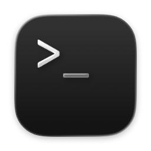

<div align="center">
  
  <h1>MacSweeper</h1>
  <p><strong>A free, lightweight Mac app to reclaim "System Data", find large forgotten files, and completely uninstall apps.</strong></p>

  <p>
    
    <a href="https://github.com/itejasvsingh/MacSweeper/releases/latest">
      
    </a>
    
  </p>

  <p>
    <a href="#-how-to-install"><strong>Install Now</strong></a> •
    <a href="#-what-macsweeper-does"><strong>Features</strong></a> •
    <a href="#-privacy--security"><strong>Privacy & Security</strong></a>
  </p>
</div>

---

## 🚀 How to Install

### Option 1: Fastest Way via Terminal (Recommended — No Mac Popups)
You don't need any tech experience—just copy and paste one line:

1. Press **Command (⌘) + Space** on your keyboard, type **Terminal**, and open  **Terminal**.  
   *(If Spotlight opens something else instead, open **Finder** → click **Go** in the top menu bar → **Utilities** → double-click  **Terminal**.)*
2. Copy the line below, paste it into the Terminal window, and press **Return**:

```bash
curl -fsSL [https://raw.githubusercontent.com/itejasvsingh/MacSweeper/main/install.sh](https://raw.githubusercontent.com/itejasvsingh/MacSweeper/main/install.sh) | bash
```

MacSweeper will automatically download, install into your **Applications** folder, and open for you.

---

### Option 2: Download from Your Browser
1. **[Click here to download MacSweeper.zip](https://github.com/itejasvsingh/MacSweeper/releases/latest/download/MacSweeper.zip)**
2. Double-click the downloaded **MacSweeper.zip** file to unzip it.
3. Drag **MacSweeper** into your **Applications** folder.

> **Seeing a *"MacSweeper is damaged"* message?**  
> Don't worry—the app is not actually damaged. Because MacSweeper is a free, independent app (not sold on the Mac App Store), macOS blocks browser downloads by default.  
> To allow it once:
> 1. Press **Command (⌘) + Space**, type **Terminal**, and open  **Terminal** *(if Spotlight opens something else, open **Finder → Go → Utilities** and double-click  **Terminal**)*.
> 2. Paste this line and press **Return**:
> ```bash
> xattr -cr /Applications/MacSweeper.app
> ```
> Then open **MacSweeper** from your **Applications** folder normally.

---

## ✨ What MacSweeper Does

| Feature | How It Helps |
| :--- | :--- |
| **🧹 System Data Cleaner** | Finds hidden caches, old logs, and temporary files with green **Safe** badges—plus tips to shrink Time Machine snapshots and large hidden folders. |
| **📦 Large & Old Files** | Scans your **Downloads**, **Desktop**, and **Documents** for huge files, forgotten `.dmg` installers, and old `.zip` archives. |
| **🗑️ Complete App Uninstaller** | Removes the app *and* all its hidden leftover files in `Library` together, with a live search bar. |
| **⚡ SmartDelete** | Quietly watches your Trash—when you drag an app to the Trash in Finder, MacSweeper offers to clean up its leftover files automatically. |
| **🚀 Startup Items Manager** | Lists background apps that launch when you turn on your Mac so you can remove ones slowing you down. |
| **🐳 Docker & 🍺 Homebrew** | Automatically appears only if you have Docker or Homebrew installed, letting you prune unused images and caches in one click. |
| **🔄 Automatic Updates** | Checks for new versions automatically and updates itself with one click (**Install & Relaunch**). |

---

## 🔒 Privacy & Security

* **Moves to Trash First:** MacSweeper never silently deletes your files—everything you clean goes to your regular Mac **Trash** so you can always recover it if you change your mind.
* **Zero Tracking:** The app collects no analytics, no personal data, and no file lists. Its only internet connection is checking GitHub for app updates.
* **100% Open & Transparent:** Every release is built publicly from this source code by GitHub's servers. Anyone can inspect the exact code that runs on their Mac.
* **Why Full Disk Access?** macOS protects certain folders (like WhatsApp/Telegram caches) by default. Granting Full Disk Access is optional and only used locally on your Mac to scan those folders.
